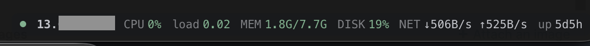

# tabby-server-performance

A [Tabby](https://tabby.sh) plugin that shows live performance stats for the server
behind each SSH tab, in a small bar in the corner of the terminal.



| Field | What it shows | Yellow / red at |
| --- | --- | --- |
| CPU | CPU usage since the previous sample | 70% / 90% |
| load | 1-minute load average | 80% / 120% of the CPU count |
| MEM | Used / total memory (excluding cache) | 80% / 92% |
| DISK | Usage of `/`, same formula as `df` | 80% / 92% |
| NET | Receive / transmit rate, all interfaces except loopback and container bridges | |
| up | Uptime | |

Hover the bar for details (all load averages, swap, free disk space). Click it to
collapse it to just the host name; the choice is remembered.

## How it works

- **Tabby SSH profiles:** stats are read over a short-lived exec channel on the tab's
  own SSH connection. No extra login, no extra credentials.
- **`ssh` typed into a local tab (macOS / Linux):** the plugin finds the running `ssh`
  process and opens its own non-interactive connection with the same arguments. If
  your `~/.ssh/config` uses `ControlMaster`, it rides on your existing connection and
  waits until you have logged in; otherwise it keeps its own multiplexed connection
  open for 60 seconds so polls don't log in every time.

The bar refreshes every 3 seconds, only while the tab is visible. On the server it
runs a small read-only shell script (`/proc`, `df`, `awk`). Nothing is installed or
written on the server.

The plugin's own connection always disables port, agent and X11 forwarding, runs
with `BatchMode=yes` (it never prompts for a password) and ignores `RemoteCommand`
and `LocalCommand` from your SSH config.

## Requirements

- Tabby (tested with 1.0.238)
- The server: Linux with `/proc`, a POSIX `sh`, `awk` and `df`. Other systems show
  "stats need Linux /proc".
- For `ssh` typed into local tabs: key or agent authentication, or `ControlMaster`
  (see below). Not available on Windows; Tabby SSH profiles work everywhere.

## Installation

Tabby loads plugins from `node_modules` inside its plugin folder:

| OS | Plugin folder |
| --- | --- |
| macOS | `~/Library/Application Support/tabby/plugins` |
| Linux | `~/.config/tabby/plugins` |
| Windows | `%APPDATA%\tabby\plugins` |

1. Clone the repository:

   ```sh
   git clone https://github.com/tpecca/tabby-server-performance.git ~/github/tabby-server-performance
   ```

2. Link it into the plugin folder (macOS shown; use the Linux path from the table
   on Linux):

   ```sh
   PLUGINS="$HOME/Library/Application Support/tabby/plugins/node_modules"
   mkdir -p "$PLUGINS"
   ln -s ~/github/tabby-server-performance "$PLUGINS/tabby-server-performance"
   ```

   On Windows, from a Command Prompt:

   ```bat
   mkdir "%APPDATA%\tabby\plugins\node_modules"
   mklink /J "%APPDATA%\tabby\plugins\node_modules\tabby-server-performance" C:\path\to\tabby-server-performance
   ```

3. Quit Tabby completely and start it again.

4. Open an SSH tab. The bar appears in the bottom right corner of the terminal.

To update, `git pull` in the repository and restart Tabby. To uninstall, delete the
link from the plugin folder and restart Tabby.

### Password logins in local tabs

The plugin can't type your password. If you log in with a password by typing `ssh`
in a local tab, let OpenSSH share one connection per host by adding this to
`~/.ssh/config`:

```
Host *
  ControlMaster auto
  ControlPath ~/.ssh/cm-%C
  ControlPersist 10m
```

Then log in as usual. While you type the password, the bar shows "waiting for login";
stats appear about a second after you are in. Sessions opened before the change don't
count, so reconnect once. (Tabby SSH profiles don't need this.)

## Bar messages

| Message | Meaning |
| --- | --- |
| waiting for login | Your `ssh` is still logging in; only the local control socket is checked meanwhile |
| not connected | The Tabby SSH tab is disconnected |
| stats need key auth or ControlMaster | The server wants a password; see [Password logins](#password-logins-in-local-tabs) |
| stats: host key not trusted | The host key isn't in `known_hosts` yet |
| stats: host unreachable | The plugin's connection timed out or was refused |
| stats need Linux /proc | The server isn't Linux |

Hover the bar to see the full error. After an error the plugin retries every 15 seconds.

## Troubleshooting

- **No bar at all:** check that the link in the plugin folder resolves to this
  repository, and that `pluginBlacklist` in Tabby's `config.yaml` (next to the
  `plugins` folder) doesn't list `server-performance`. Tabby matches blacklist
  entries against the plugin name without its `tabby-` prefix, and disabling a
  plugin under Settings > Plugins adds it there.
- **Warnings:** open Tabby's developer tools and look for `[tabby-server-performance]`
  in the console.

## Development

`index.js` is plain CommonJS with no build step and no dependencies: Tabby provides
`@angular/core` and `tabby-terminal` at runtime. Edit the file and restart Tabby.

## License

[MIT](LICENSE)
